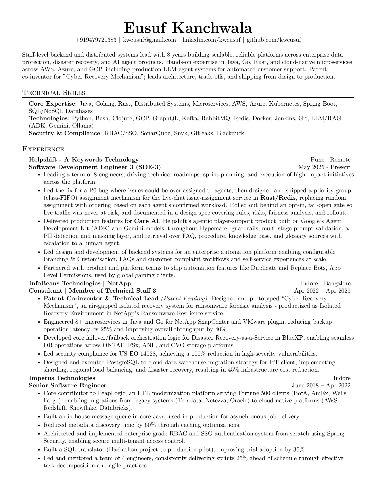
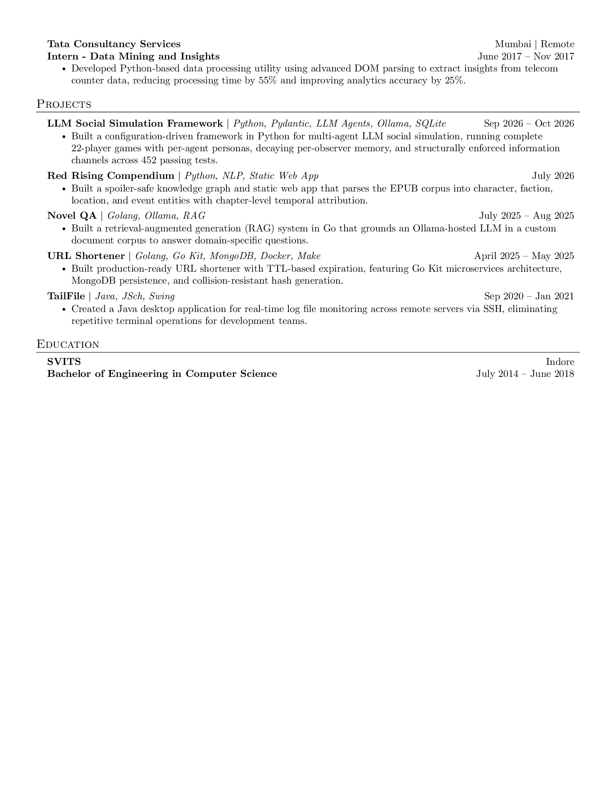

<!-- GitHub cannot embed a PDF in a README (its sanitizer strips iframes/embeds),
     so every page is rendered to an image by update-resume-preview.sh. -->

  

  

  <a href="./resume.pdf">Full resume (PDF)</a>
  &nbsp;·&nbsp;
  <a href="./resume-1page.pdf">Condensed PDF</a>
  &nbsp;·&nbsp;
  <a href="https://kweusuf.is-a.dev">Portfolio</a>

